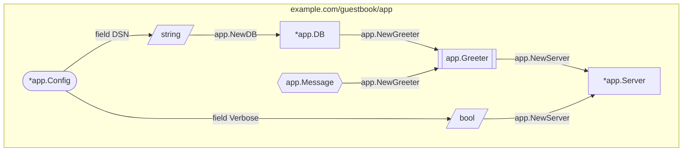

# Wire Command Line Reference

The `wire` binary is both a code generator and an analysis tool. It has five
commands:

| Command | Purpose |
| --- | --- |
| [`gen`](#gen) | Write the `wire_gen.go` file for each package. This is the default. |
| [`diff`](#diff) | Show what `gen` would change, without writing anything. |
| [`check`](#check) | Report Wire errors without generating code. |
| [`show`](#show) | Describe provider sets: their imports, inputs and outputs. |
| [`graph`](#graph) | Render the dependency graph as a Mermaid or Graphviz diagram. |

Install it with:

```shell
go install github.com/wireinject/wire/cmd/wire@latest
```

## Conventions shared by all commands

### Package patterns

Every command takes zero or more package patterns, in the same form the `go`
tool accepts: `.`, `./cmd/app`, `./...`, `example.com/foo/...`. If no pattern is
given, it defaults to `.` (the current directory) — not `./...`.

### Build tags

Wire always loads packages with the `wireinject` build tag set, which is how it
sees the injector templates in your `wire.go`. The `-tags` flag, accepted by
every command, appends to that tag list rather than replacing it:

```shell
wire check -tags "integration debug" ./...
```

### Exit codes

Unless noted otherwise, commands exit `0` on success, `1` on failure (load
errors, Wire errors, failure to write a file) and `2` on a usage error such as
an unrecognized flag value. [`diff`](#diff) assigns a different meaning to `1`.

Diagnostics and progress messages go to stderr with a `wire: ` prefix; only the
actual output (a diff, a description, a diagram) goes to stdout, so redirecting
stdout to a file never captures log noise.

### The default command

If the first argument is not one of the command names, Wire assumes you meant
`gen` and treats the argument as a package pattern. So `wire ./...` is the same
as `wire gen ./...`.

This also means a mistyped or unsupported command is silently read as a package
pattern: `wire version` does not print a version, it tries to load a package
named `version` and fails with a confusing error. Spell the command out when in
doubt.

## gen

```
wire gen [-header_file path] [-output_file_prefix string] [-tags tag,list] [packages]
```

Runs dependency injection for each package and writes the result to
`wire_gen.go` in that package's directory. Packages that contain no Wire
directives are skipped silently. Each file written is logged:

```
wire: example.com/guestbook: wrote /home/me/guestbook/wire_gen.go
```

| Flag | Meaning |
| --- | --- |
| `-header_file` | Path to a file whose contents are inserted at the top of every generated file, typically a license header. |
| `-output_file_prefix` | String prepended to the output file name, so `-output_file_prefix gen_` writes `gen_wire_gen.go`. |
| `-tags` | Extra build tags, see [Build tags](#build-tags). |

The usual way to run it is from a `//go:generate` directive; see
[Wiring it into `go generate`](#wiring-it-into-go-generate) for where that
directive has to live.

## diff

```
wire diff [-header_file path] [-tags tag,list] [packages]
```

Generates the same content as `gen` but, instead of writing it, prints a
unified diff against the `wire_gen.go` currently on disk. Useful in CI to prove
that the checked-in generated code is up to date.

Exit codes differ from the other commands, mirroring `diff(1)`:

| Code | Meaning |
| --- | --- |
| `0` | No difference. |
| `1` | At least one package differs. |
| `2` | Trouble: the packages could not be loaded or generation failed. |

One exception: if `-header_file` cannot be read, `diff` exits `1` rather than
`2`, because that check happens before the `diff`-style codes take over.

## check

```
wire check [-tags tag,list] [packages]
```

Loads the packages and reports any type-checking or Wire errors found in
top-level provider sets and injector functions — missing providers, duplicate
bindings, cycles, inaccessible fields — without generating or writing anything.
Exits `1` if there were errors, `0` if the packages are clean.

This is the cheapest command to put in a pre-commit hook or CI job when you
only care that the wiring is valid.

## show

```
wire show [-tags tag,list] [packages]
```

Describes every provider set declared as a top-level variable: the other
provider sets it imports, and the types it can produce, grouped by the inputs
those outputs require. Injector functions in the packages are listed at the
end.

```
"example.com/guestbook".Set
	Outputs given no inputs:
		example.com/guestbook/app.Message
			at /home/me/guestbook/wire.go:15:13
	Outputs given *example.com/guestbook/app.Config:
		*example.com/guestbook/app.DB
			at /home/me/guestbook/app/app.go:10:6
		example.com/guestbook/app.Greeter
			at /home/me/guestbook/app/app.go:23:6
		...

Injectors:
	"example.com/guestbook".buildServer
```

`show` is a flat, textual inventory. To see how the types connect to each
other, use `graph`.

## graph

```
wire graph [-format mermaid|dot] [-injector name] [-set name] [-output path] [-tags tag,list] [packages]
```

Renders the dependency graph of each injector in the given packages as a
diagram: one node per type, one edge per provider call. `graph` performs the
same analysis as `check` and reports the same errors, so an injector that does
not resolve is not drawn — fix the errors first.

The shortest useful invocation writes a Markdown file for the whole module:

```shell
wire graph -output DEPS.md ./...
```

GitHub renders the Mermaid blocks in that file directly, so committing it gives
you a dependency diagram in code review.

### Choosing what to graph

By default every injector in the matched packages is graphed, each as its own
diagram. Narrow it down with one of:

| Flag | Meaning |
| --- | --- |
| `-injector` | Graph only this injector. Accepts the bare function name (`buildServer`), the qualified name (`example.com/guestbook.buildServer`) or the quoted form (`"example.com/guestbook".buildServer`). |
| `-set` | Graph a top-level provider set instead of injectors, rooted at every type the set can produce. Accepts the variable name (`Set`) or the same qualified forms. |

Names are matched exactly, so a bare name may match sets in several packages;
all matches are graphed.

### Output formats

`-format=mermaid` (the default) writes a Markdown document: one `## <target>`
heading and one fenced ` ```mermaid ` block per injector or provider set.
Several graphs in one document is the normal case.

`-format=dot` writes Graphviz DOT. A DOT file holds exactly one digraph, so
this format refuses to render more than one target at a time:

```
wire: dot output got 2 graphs: format supports only one graph at a time; use -injector or -set to select one
```

Pipe it into Graphviz to get an image:

```shell
wire graph -format=dot -injector=buildServer ./cmd/app | dot -Tsvg -o deps.svg
```

### Reading the diagram

Every node is a type. Its shape says where the type comes from:

| Meaning | Mermaid | DOT |
| --- | --- | --- |
| Produced by a provider function or struct | `["*app.DB"]`, a box | box |
| Produced via `wire.Bind`, i.e. an interface | `[["app.Greeter"]]`, a double box | double outline |
| Injector argument, or an input nothing provides | `(["*app.Config"])`, a stadium | ellipse |
| `wire.Value` or `wire.InterfaceValue` | `{{"app.Message"}}`, a hexagon | hexagon |
| `wire.FieldsOf` | `[/"string"/]`, a parallelogram | parallelogram |

Edges point from a dependency to the thing that consumes it, labelled with the
provider that makes the connection: `app.NewDB` for a provider function,
`app.NewBox[int]` for a generic provider instantiated with explicit type
arguments, `field DSN` for a field pulled out by `wire.FieldsOf`.

Nodes are grouped into a subgraph per declaring package, by import path; types
with no package of their own, such as `map[string]string`, are collected under
`(unnamed types)`.

Putting it together, this provider set

```go
var Set = wire.NewSet(
	app.NewDB,
	app.NewGreeter,
	wire.Bind(new(app.Greeter), new(*app.MessageGreeter)),
	app.NewServer,
	wire.Value(app.Message("Hello, world!")),
	wire.FieldsOf(new(*app.Config), "DSN", "Verbose"),
)

func buildServer(cfg *app.Config) *app.Server {
	wire.Build(Set)
	return nil
}
```

produces:

````markdown
## buildServer


````

`*app.Config` is a stadium because it is the injector's argument, `app.Greeter`
is doubled because `wire.Bind` provides it, `app.Message` is a hexagon because
it comes from `wire.Value`, and `string` and `bool` are parallelograms because
`wire.FieldsOf` pulled them out of the config.

### Writing to a file

`-output` and a shell redirect both work, but they fail differently:

```shell
wire graph -output DEPS.md ./...   # writes only after the diagram renders
wire graph ./... > DEPS.md         # shell truncates DEPS.md before wire starts
```

With the redirect, a load error leaves you with an empty `DEPS.md`, because the
shell creates the file before `wire` gets to run. `-output` writes the file only
once rendering succeeded, and logs `wire: wrote DEPS.md`. Prefer it unless you
are piping into another tool.

### Wiring it into `go generate`

```go
//go:generate wire
//go:generate wire graph -output ../../DEPS.md .
```

Put these directives in an ordinary file such as `main.go` or a `doc.go`, **not
in `wire.go`**. `wire.go` carries the `//go:build wireinject` constraint, and
`go generate` skips files excluded by the current build constraints, so a
directive there never runs unless you remember to say
`go generate -tags wireinject ./...`. The working directory of a directive is
the directory of the file containing it, which is why the example writes to
`../../DEPS.md` to reach the repository root from `cmd/app`.

### Checking for a stale diagram in CI

There is no `graph -diff`; compare the output yourself:

```shell
wire graph ./... | diff -u DEPS.md - || {
	echo "DEPS.md is out of date; run go generate ./..." >&2
	exit 1
}
```

## Built-in help commands

`wire commands` lists the available commands, `wire flags <command>` lists one
command's flags, and `wire help <command>` prints its full usage text:

```shell
wire help graph
```
